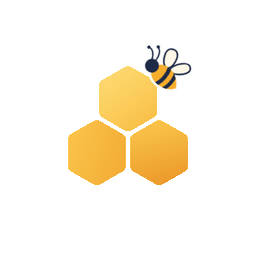
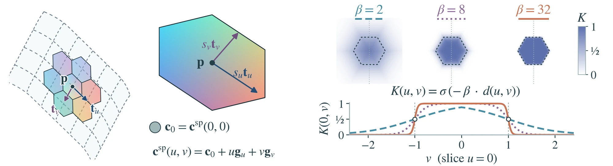
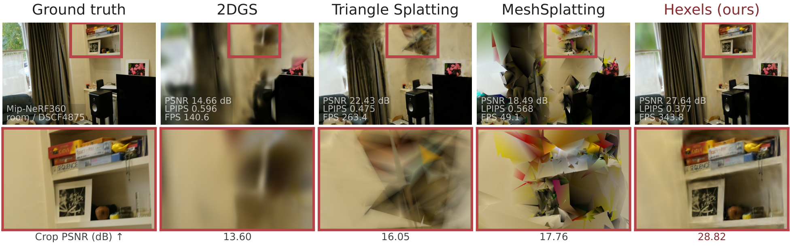
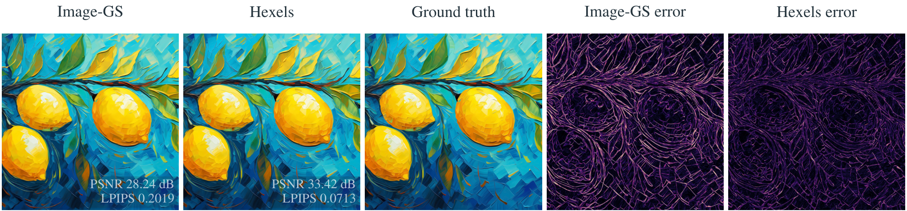
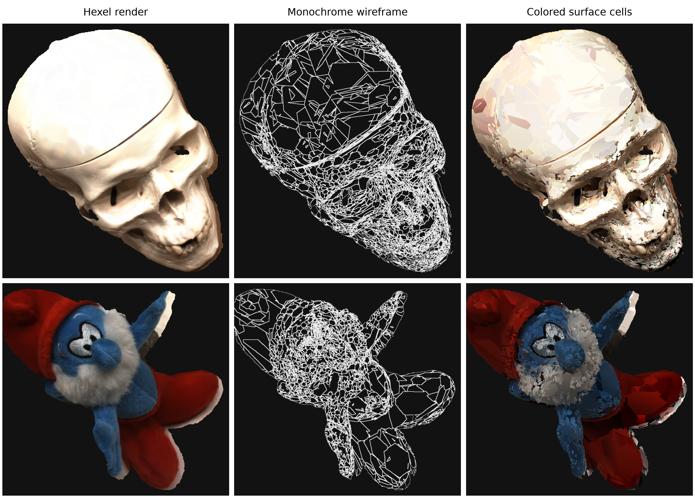

<h1 align="center"> Honeycomb-Surfels</h1>

<p align="center"><strong>Compact Hexagonal Primitives for Efficient Scene Rendering and Reconstruction</strong></p>

<p align="center"><a href="https://toshi2k2.github.io/">Prakhar Kaushik*</a> · <a href="https://mvp18.github.io/">Soumava Paul*</a> · <a href="https://www.cs.jhu.edu/~ayuille1/">Alan Yuille</a><br><sub>CCVL, Johns Hopkins University · * Equal contribution</sub></p>

<p align="center"><a href="https://honeycomb-surfels.github.io/">Project</a> · <a href="https://honeycomb-surfels.github.io/h1.pdf">Paper</a> · <a href="https://arxiv.org/abs/2610.37668">arXiv</a> · <a href="https://huggingface.co/jhu-ccvl/Hexels">Pretrained models</a></p>

<p align="center">
  <a href="hexel_edge/"></a>
</p>

<p align="center"><strong>3D scenes on your own device. Your captures stay with you.</strong><br>
Our open-source Hexels app now captures, prepares, trains and renders scenes locally on a physical iPad, with separate captured-mesh and learned-patch exports. Built for Apple devices; physical iPhone validation is next.<br>
<sub>Under development · Independent work, without company or industry sponsorship or backing.</sub></p>

<p align="center"><a href="hexel_edge/"></a></p>

<blockquote>
<p><sub><strong>Abstract.</strong> Novel view synthesis and 3D reconstruction have advanced rapidly with radiance fields and splatting, yet their memory and computational demands limit their use in resource-constrained settings. We introduce Hexels: novel planar hexagonal surface elements with a first-order spatial color field for efficient 3D scene and 2D image representation. Hexels exploit locally planar regions with smoothly varying appearance using fewer, larger primitives. Their hexagonal support provides an area- and boundary-efficient domain, while the local color field captures appearance variation within each primitive. Across 34 scenes, Hexels improve PSNR over memory-matched 2DGS by 4.53–7.38 dB across datasets while requiring lower training VRAM. We further ablate Hexels by showing that per primitive, Hexels outperform 2DGS by upto 4.74 dB while using lower training VRAM and having 2.31× faster FPS. Even in unconstrained settings, Hexels offers complementary quality-memory trade-offs. For efficient 3D surface reconstruction, Hexels reduce error by 28.9% compared with memory-matched 2DGS across 15 DTU scans. On 6 Tanks and Temples surface scenes, Hexels achieves the highest mean F1 among compared methods (34.38%, versus 31.72% for 2DGS). We further also show that Hexels, as a general primitive, improves 2D image representation over Image-GS. Hexels push the Pareto frontier on the quality-efficiency trade-off of surface-aligned primitives.</sub></p>
</blockquote>



**Start with:** [3D scenes](#train-and-render-a-3d-scene) · [2D images](#fit-and-decode-a-2d-image) · [Surfaces and wireframes](#surfaces-and-wireframes) · [Browser viewer](#view-in-your-browser) · [Paper experiments](#reproduce-the-paper)

## Setup

The Python trainer, image decoding and CUDA rendering use an NVIDIA GPU. Exported 3D scenes can be viewed in a WebGL2 browser. The [Hexel Edge Apple app](hexel_edge/) provides guided capture, local Hexels training, novel-view rendering, separate surface exports and device quality controls. It is an independent experimental project; see its measured platform limits and build instructions.

<details>
<summary><strong>Requirements</strong></summary>

| Component | Tested configuration |
|---|---|
| System | Linux x86-64, Python 3.11 |
| PyTorch | 2.5.1 with CUDA 12.1 |
| Build tools | CUDA toolkit 12.3 with `nvcc`, C++17 compiler |
| GPU | NVIDIA RTX A5000, 24 GB, compute capability 8.6 |

Use the pinned environment below for numerical comparisons. A CUDA toolkit from the 12.x family, version 12.1 or later, is needed to build the extensions; the PyTorch CUDA runtime alone is insufficient. Other GPU architectures need their own `TORCH_CUDA_ARCH_LIST` and a rebuild. Memory use depends on the image size, primitive count and requested outputs; 24 GB is the tested device capacity.

</details>

<details>
<summary><strong>Install</strong></summary>

Clone the repository with its [kernel](https://github.com/honeycomb-surfels/hexel-kernel) and [viewer](https://github.com/honeycomb-surfels/hexel-viewer) submodules, then install from the repository root:

```bash
git clone --recurse-submodules https://github.com/honeycomb-surfels/hexels.git
cd hexels
CONDA_CHANNEL_PRIORITY=flexible conda env create -p .envs/hexels311 -f environment.yml
conda activate ./.envs/hexels311
git submodule update --init --recursive
python -m pip install -e .
python -m pip install -e submodules/hexel-viewer
python -m scripts.fetch_baselines --methods image-gs 2d-gaussian-splatting fused-ssim
```

Set `CUDA_HOME` to your toolkit and build on a GPU machine. The architecture below is for the RTX A5000; use your GPU's compute capability when building elsewhere.

```bash
export CUDA_HOME=/path/to/cuda-12.3
export PATH="$CUDA_HOME/bin:$PATH"
export TORCH_CUDA_ARCH_LIST=8.6
export MAX_JOBS=4
python -m pip install --no-build-isolation submodules/hexel-kernel
python -m pip install --no-build-isolation 2d-gaussian-splatting/submodules/diff-surfel-rasterization
python -m pip install --no-build-isolation 2d-gaussian-splatting/submodules/simple-knn
python -m pip install --no-build-isolation ./fused-ssim
```

Two optional environments support official T&T surface evaluation and rebuilding MVS initialization packs:

```bash
conda env create -p .envs/tnt-eval -f environment-tnt-eval.yml
CONDA_OVERRIDE_CUDA=12.1 CONDA_CHANNEL_PRIORITY=flexible conda env create -p .envs/colmap37 -f environment-colmap.yml
```

The kernel uses the `gsplat` Python import name. Keep the bundled kernel installed rather than replacing it with the unrelated PyPI `gsplat` package. External baselines use their own environments; follow the [baseline guide](baselines/README.md) when you need them.

</details>

<details>
<summary><strong>Datasets and pretrained models</strong></summary>

For image fitting, start with your own RGB image or the [Image-GS image benchmark](https://github.com/NYU-ICL/image-gs#setup). The paper uses its 45 images at 2048 × 2048 pixels.

For 3D, the [dataset guide](docs/datasets_2dgs.md) gives downloads, camera conventions and reference geometry. The expected layouts are:

| Dataset | Directory |
|---|---|
| Mip-NeRF 360 | `data/mipnerf360/<scene>/{sparse/0,images_2,images_4}` |
| DTU | `data/dtu/<scan>/`, with images, masks and `cameras.npz` |
| Tanks and Temples NVS | `data/tnt_nvs/<scene>/` |
| Tanks and Temples surfaces | `data/tanks_and_temples/<scene>/` from the GOF pack |

After downloading the GOF pack, prepare the ten-scene T&T NVS set and the surface-evaluation references with:

```bash
python -m scripts.prepare_nvs_data --geometry-root data/tanks_and_temples
python -m scripts.download_geometry_references dtu
python -m scripts.download_geometry_references tanks_and_temples
```

Mip-NeRF 360 uses `images_4` outdoors and `images_2` indoors. T&T NVS uses the prepared half-resolution images without further downsampling; DTU uses resolution factor 2. The NVS and surface experiments have different camera splits.

[Paper checkpoints are on Hugging Face](https://huggingface.co/jhu-ccvl/Hexels). The [catalog](https://huggingface.co/jhu-ccvl/Hexels/blob/main/catalog.json) lists models, expected metrics and checksums; the [checkpoint guide](docs/checkpoints.md) gives download and evaluation commands. Dataset images are downloaded separately. Use the original FP32 checkpoints for the 3D paper results; optional compressed files have separate metric records.

</details>

## Train and render a 3D scene



<sub>From Figure 5 of the paper: Room (Mip-NeRF 360), under matched model-memory budgets, using fixed-population Hexels V1. The same shelf detail is enlarged for each method.</sub>

Start with a registered scene in the dataset layout above. This example trains DTU scan24 for 30K steps, holding out every eighth registered view for testing:

```bash
python -m scripts.train_scene --source data/dtu/scan24 --dataset dtu \
  --variant v3 --output outputs/scan24
python -m hexels.render --checkpoint outputs/scan24/checkpoints/ckpt_030000.pt \
  --model_path outputs/scan24 --split test --skip_path
```

The checkpoint is saved under `checkpoints/`; test renders are written to `outputs/scan24/test/ours_30000/renders/`. Use a fresh output directory for each run.

All three variants use a local spatial color gradient. Choose how much view-dependent appearance you need:

| Variant | Appearance | Learned FP32 state per Hexel |
|---|---|---:|
| V1 | Spatial color | 80 bytes |
| V2 | Spatial color + linear variation with view direction | 116 bytes |
| V3 | Spatial color + degree-3 spherical harmonics for view dependence | 260 bytes |

These sizes count active learned parameters. Training VRAM and saved checkpoint bytes include additional state.

Add `--growth` to enable mixed growth and weak pruning. Without it, training keeps the population fixed. `--prepare` prints the resolved command without training; additional `hexels.train` options can follow `--`.

<details>
<summary><strong>Render a pretrained scene</strong></summary>

Install the code and matching DTU data, then download and render the FP32 checkpoint:

```bash
python -m pip install huggingface_hub
hf download jhu-ccvl/Hexels --local-dir pretrained/Hexels \
  --include "nvs/dtu/scan24/hexels_v3-sh3_fixed-sfm_seed0_step030000/*" --exclude "*.hexcodec"
model_dir=pretrained/Hexels/nvs/dtu/scan24/hexels_v3-sh3_fixed-sfm_seed0_step030000
python -m hexels.render --checkpoint "$model_dir/checkpoints/ckpt_030000.pt" \
  --model_path "$model_dir" --out_dir outputs/pretrained_render/scan24 --split test --skip_path
```

</details>

<details>
<summary><strong>Evaluate with the paper's metrics</strong></summary>

The paper evaluates float renders directly. `hexels.metrics` instead scores saved PNGs. To evaluate the scene and variant above with the paper protocol, download its evaluation job and camera contract:

```bash
hf download jhu-ccvl/Hexels --local-dir pretrained/Hexels \
  nvs/dtu/scan24/hexels_v3-sh3_fixed-sfm_seed0_step030000/evaluation_job.json \
  cameras/nvs/dtu/scan24/settings.json cameras/nvs/dtu/scan24/contract.json
python -m scripts.evaluate_nvs_campaign evaluate \
  --job pretrained/Hexels/nvs/dtu/scan24/hexels_v3-sh3_fixed-sfm_seed0_step030000/evaluation_job.json \
  --model-path outputs/scan24 --result outputs/scan24_eval/metrics.json
```

Fresh training can give different values even with the same seed: CUDA gradient accumulation uses atomic additions whose order can vary. Evaluate the published checkpoint to check the corresponding paper result. [More evaluation examples](docs/checkpoints.md).

</details>

## Fit and decode a 2D image



<sub>From Figure 3 of the paper: a 2048 × 2048 Image-GS benchmark image, fitted with 10K primitives per method. Both error maps share the same scale; brighter colors indicate larger errors.</sub>

Fit an RGB image, then render its stored Hexel representation:

```bash
python -m scripts.fit_image --image path/to/image.png \
  --output outputs/my_image --variant rich
python -m scripts.decode_image outputs/my_image/step_005100_mixed14.hxm \
  outputs/my_image/reconstruction.png
```

The default fit runs for 5,100 steps, starting with 20K Hexels and pruning to 10K. `rich` learns spatial color gradients; `flat` uses constant color and fixed softness. Fitting also saves the raw FP32 parameters. The `.hxm` file uses the paper's packed precision profile, so decoded and raw-FP32 quality are separate measurements.

<details>
<summary><strong>Change the budget, compare Image-GS or evaluate an image</strong></summary>

Use `--count` for the target population and `--allocation fixed`, `grow` or `prune` to choose how it is reached. Hexel pruning starts from `--initial-count` and preserves each survivor's optimizer state. `--steps`, `--loss` and `--seed` control fitting; `python -m scripts.fit_image --help` lists the options.

For native Image-GS, use its growth recipe:

```bash
python -m scripts.fit_image --image path/to/image.png --output outputs/imagegs \
  --variant imagegs --allocation grow --steps 10000 --loss l1_ssim
```

To score the decoded Hexel file against the input:

```bash
python -m scripts.evaluate_image --model outputs/my_image/step_005100_mixed14.hxm \
  --image path/to/image.png --output outputs/my_image/decoded_metrics.json
```

`flat` writes `step_005100_balanced.hxm`; `rich` writes `step_005100_mixed14.hxm`. Uniform uint16 `.hxc` and raw `render_parameters_005100.pt` files are saved as well. The evaluator accepts all three and records the input condition. Image metrics use AlexNet-LPIPS; 3D NVS uses VGG-LPIPS. See the [image-model guide](docs/checkpoints.md#image-models) for the stored formats.

</details>

## Surfaces and wireframes



Surface reconstruction fuses rendered depths into a triangle mesh. Wireframe export reads the learned Hexels directly and writes their hexagonal boundaries and colored faces.

The examples on the right show DTU scan65 and scan83. Each row contains the Hexel render, visible-cell boundaries and spatial color on the cells. The panels use dataset foreground masks and the same crop.

The exported PLY contains faces, line segments and primitive IDs. The cells remain independent polygons. This exporter supports base Hexels; checkpoints containing child primitives are rejected.

Export the fixed-population model trained above on CPU:

<br clear="both">

```bash
python -m scripts.extract_hexels_wireframe \
  --checkpoint outputs/scan24/checkpoints/ckpt_030000.pt \
  --output outputs/scan24/hexel_cells.ply --color-mode spatial --min-opacity 0.2
```

<details>
<summary><strong>Train and extract a surface mesh</strong></summary>

Official surface evaluation uses models trained on all registered views, with normal-consistency and ray-distortion losses. Download a published MVS initialization pack for this example:

```bash
hf download jhu-ccvl/Hexels --local-dir pretrained/Hexels --include "mvs/dtu/scan24/*"
python -m scripts.train_scene --source data/dtu/scan24 --dataset dtu --variant v3 \
  --all-views --surface --init-geometry pretrained/Hexels/mvs/dtu/scan24/initial_geometry.pt \
  --output outputs/scan24_surface
python -m scripts.extract_hexels_dtu_mesh \
  --checkpoint outputs/scan24_surface/checkpoints/ckpt_030000.pt
```

The extractor uses median depth and TSDF fusion. It writes `train/ours_30000/fuse.ply` and `fuse_post.ply` under the model directory. Omit `--init-geometry` to start from SfM points, or use `scripts.prepare_mvs_geometry` to rebuild an MVS pack. The [surface-checkpoint guide](docs/checkpoints.md#surface-checkpoints) gives dataset-specific extraction settings and DTU/T&T evaluation commands.

Held-out NVS checkpoints and all-view surface checkpoints serve different experiments. Use the all-view models for official surface evaluation. The code also includes contact-patch extraction and an [extraction benchmark](scripts/run_extraction_benchmark.py).

</details>

## View in your browser

Export a checkpoint and serve the resulting directory:

```bash
python -m hexel_viewer.viewer_model outputs/scan24/checkpoints/ckpt_030000.pt \
  outputs/scan24_site --site
python -m http.server 8081 --bind 127.0.0.1 --directory outputs/scan24_site
```

Open [localhost:8081/?model=model.hexview](http://127.0.0.1:8081/?model=model.hexview). Export can run on CPU; the page renders in a WebGL2 browser and the complete exported directory can be hosted elsewhere. Camera views are included when the checkpoint's `source_path` resolves, or when you pass `--source-path data/dtu/scan24`.

The [viewer repository](https://github.com/honeycomb-surfels/hexel-viewer) also includes a CUDA viewer and live training viewer. Live viewing adds work during training; keep it off when measuring training time.

## Reproduce the paper

For the published numbers, begin with the [checkpoint guide](docs/checkpoints.md). For fresh experiments, choose the setup that answers your question:

| Experiment | Where to start |
|---|---|
| Novel-view synthesis | [NVS settings](configs/nvs.json), [experiment guide](docs/experiments.md#current-nvs-campaign) and `scripts.run_nvs_campaign` |
| Model-memory or primitive-budget comparisons | [Capacity settings](configs/capacity.json) and `scripts.prepare_nvs_budget_sweep` |
| DTU/T&T surface reconstruction | [Surface checkpoints and evaluation](docs/checkpoints.md#surface-checkpoints) |
| Training GPU memory | [Measurement protocol](docs/experiments.md#training-memory); use `resources_training.json`'s `peak_gpu_bytes / 2**30` for GiB |
| New geometry-loss or extraction ablations | `scripts.run_surface_ablation` and `scripts.run_extraction_benchmark` |

The NVS runner checks a few scenes before starting the full benchmark, records the code and environment, and verifies the camera and measurement settings. Run prepared jobs locally or submit them through Slurm; the [experiment guide](docs/experiments.md#slurm-and-local-runs) explains both paths.

The [baseline guide](baselines/README.md) lists upstream revisions, installation steps, licenses and adaptations. Install only the methods you need. Model-memory budgets count the learned scene representation, including required textures or grids; training VRAM is measured separately. Primitive budgets are ceilings, so adaptive methods can finish below the limit.

The older staged training recipe in `scripts.run_reproduction` uses `configs/train.json`. Its geometry ablations are templates for new runs, rather than replacements for the paper's all-view surface recipe. [Experiment conventions](docs/experiments.md) explain the camera splits, losses and measurement conditions.

## Citation

```bibtex
@misc{kaushik2026honeycombsurfelscompacthexagonalprimitives,
  title={Honeycomb-Surfels: Compact Hexagonal Primitives for Efficient Scene Rendering and Reconstruction},
  author={Prakhar Kaushik and Soumava Paul and Alan Yuille},
  year={2026},
  eprint={2610.37668},
  archivePrefix={arXiv},
  primaryClass={cs.CV},
  url={https://arxiv.org/abs/2610.37668},
}
```

## License

Original Hexels code is [MIT licensed](LICENSE), copyright 2026 Prakhar Kaushik and Soumava Paul. [Hexel Edge](hexel_edge/) is separately [MIT licensed](hexel_edge/LICENSE), copyright 2026 Prakhar Kaushik. Third-party components retain their own licenses, including research/noncommercial restrictions where applicable; see [THIRD_PARTY.md](THIRD_PARTY.md). Datasets retain their original terms. Please cite the corresponding upstream work when using a baseline.
