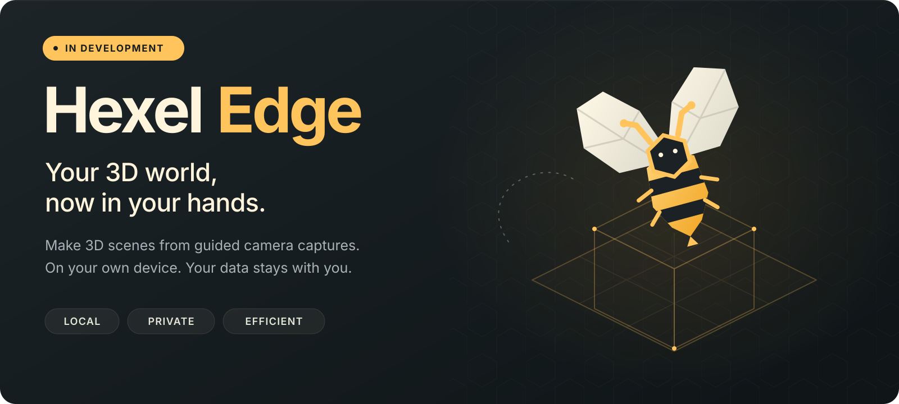
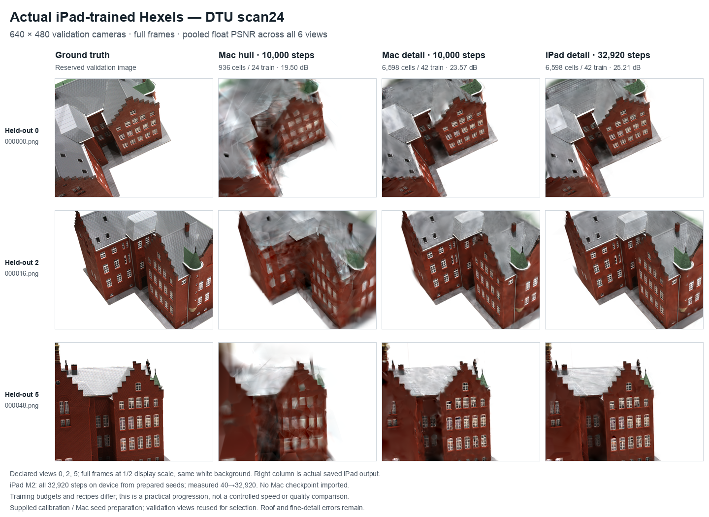
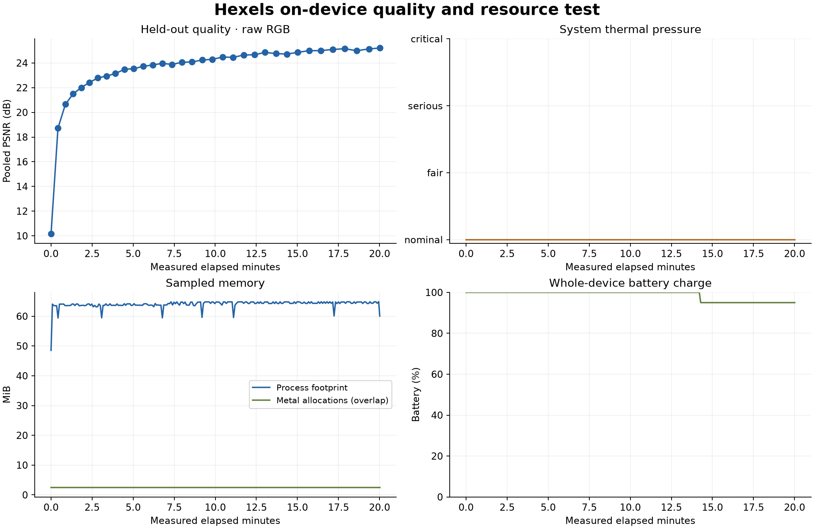
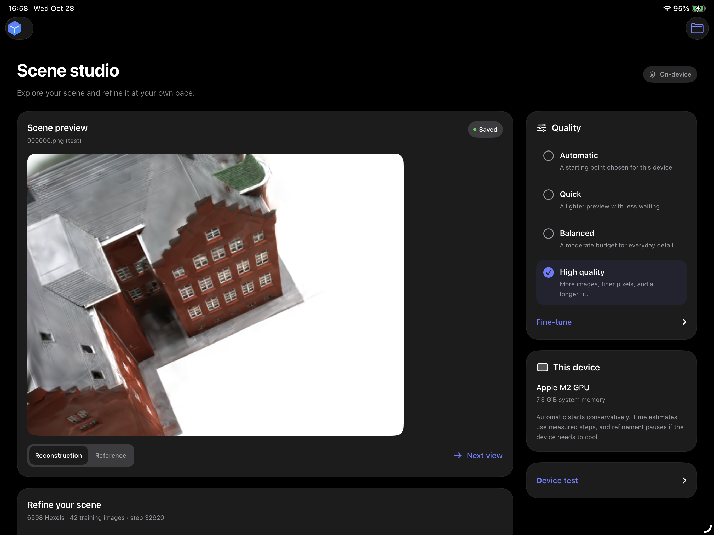

  

<strong>Under development</strong>

Capture a little of your world. Turn it into Hexels. Explore a new perspective.

Our goal: make 3D scenes from your images and videos on your own smartphone or iPad, completely privately. <strong>Private by design. Your data remains with you.</strong>

## Hexels on edge devices

**Open-source, private, on-device Hexels surface splatting.** Hexel Edge brings capture, reconstruction, training and novel-view synthesis into one local workflow for edge devices.

The complete workflow has been verified on an **iPad Pro** 6th Gen. It also runs on **Apple-silicon Macs**. iPhone build and interface has been tested in the simulator only.

This is an unfunded development effort - Hexels and anything associated with this project has been funded by none and has been completely done by us alone. Funding or hardware support - particularly a recent iPhone and additional test devices - would help us complete development and evaluate more systems.

This currently works on Apple devices (if you are from Apple, please consider funding this project.) Extension to other devices is pending.

## Capture. Reconstruct. Keep.

Capture a scene as a guided image/video sequence, or import a calibrated image bundle. Hexel Edge prepares the geometry, trains the scene locally and renders new viewpoints. The reconstruction preview updates during training; the app also supports 3D mesh inspection and local export. Images, geometry and training stay on your device. Sharing is optional.

The current implementation supports **V1 Hexels with FP32 training**. Camera poses and initial point observations come from Apple ARKit tracking, with LiDAR depth where available.

## Implementation status

| Component | Status |
|---|---|
| V1 Hexels, FP32 | ✅ Implemented |
| Metal rendering, gradients and Adam | ✅ Implemented |
| Guided capture and local initialization | ✅ Verified on M2 iPad Pro |
| ARKit camera poses / point cloud | ✅ Integrated; LiDAR depth used when available |
| Live reconstruction preview and NVS | ✅ Recorded and interpolated camera views |
| 3D surface inspection | ✅ Rotate and zoom the captured mesh |
| Scene export | ✅ Checkpoint, captured OBJ and colored Hexel-patch PLY |
| Pause, save and restore | ✅ Verified, including relaunch |
| Image / resolution / iteration controls | ✅ Device-bounded presets and manual controls |
| Mac engine | ✅ Verified on Apple silicon |
| iPhone | ◐ Build and simulator interface verified; physical testing needed |
| Non-LiDAR capture | ◐ Sparse-point fallback implemented; hardware validation needed |
| V2 and V3 Hexels | ⏳ Native implementation and validation to do |
| Densification / adaptive population | ⏳ To do |
| Standalone SfM and unposed photo/video-file import | ⏳ To do |
| Android | ⏳ Implementation to do |
| 2D image fitting in the app | ⏳ To do |
| Quantization / mixed precision | ⏳ To do |

The captured OBJ and trained Hexel PLY are separate outputs. PLY contains independent surface patches and can have gaps; fused, watertight and texture-baked mesh output remains a development task.

## Edge-device evaluation

**Device:** 12.9-inch iPad Pro, sixth generation, Apple M2, iPadOS 26.7.2.

We trained **DTU scan24 for 20 minutes directly on the iPad, offline and unplugged**. Calibration and initial feature seeds were prepared on Mac; all optimization ran on the iPad from those seeds. No trained Mac checkpoint was imported.

| Measurement | Result |
|---|---:|
| Training / reserved images | 42 / 6 |
| Training and evaluation resolution | 640 × 480 |
| Fixed Hexels | 6,598 |
| Reserved-view float-RGB PSNR | **25.21 dB** |
| Mean display-PNG SSIM | **0.7985** |
| Total on-device updates | **32,920** |
| Measured updates after warmup/prelude | 32,880 |
| Measured duration | **20 min 0.71 s** |
| Mean update-loop time | 35.40 ms |
| Sampled peak process footprint | **64.9 MiB** |
| System thermal pressure | **Nominal in all 233 samples** |
| OS battery charge | **100% → 95%** |

DTU scan24 development results. Columns use different initialization, view counts and training budgets.

Thermal categories indicate OS pressure; GPU clocks and temperature were not measured. Battery percentages are coarse whole-device readings with no idle baseline. This is one development scene, with reserved views reused during recipe selection. [Experiment details](results/README.md).

### Locally captured scene

A separate **48-image scan captured on the iPad** completed local initialization and 1,000 training updates at 640 × 360 using 20,000 Hexels. Training took **66.17 seconds**, with reserved-view PSNR improving **14.91 → 19.66 dB**. NVS, mesh inspection, export and restoration after relaunch worked. These private images and scene files are not released.

## App interface

Public DTU scene in an earlier development build. Current source adds guided capture and surface controls.

## System specifications

| Parameter | Current implementation |
|---|---|
| Platforms | iOS / iPadOS 18+; shared engine on macOS 14+ |
| Representation | V1 Hexels, FP32, fixed population |
| Guided capture | 24 / 48 / 64 views; 640 / 1280 px long edge; up to 20K initial Hexels |
| Prepared inputs | Up to 256 frames and 2048 px source long edge |
| Primitive admission | Up to 25K or 50K cells according to runtime memory budget |
| User controls | Quality preset, training-image count, resolution and additional updates |
| Automatic policy | Available memory and Metal capability / working-set guidance |
| Storage | Private local scene storage, excluded from backup; explicit export |

Limits are clamped to source data and available resources. Apple GPU memory is shared system memory. Increasing resolution or training-image count starts a fresh fit while preserving the previous checkpoint; increasing the update budget continues the current fit. Training runs in the foreground and saves a pause on backgrounding or resource pressure.

## Build and run

A public App Store or TestFlight build is not available yet. Build locally with Xcode:

1. Open `hexel_edge/apple/iOS/HexelsEdge.xcodeproj` and select the **HexelsEdge** scheme.
2. Copy `apple/iOS/Config/LocalSigning.example.xcconfig` to `LocalSigning.xcconfig` beside it and set your development Team ID. This local file is ignored by Git.
3. Connect and unlock the device, approve **Trust**, enable **Developer Mode**, select it in Xcode and run.
4. In the app, choose **Capture scene**, allow Camera, and move slowly around a static, well-lit scene with overlapping views. Use landscape orientation for upright saved previews.
5. Tap **Build scene**, select the training budget and **Refine**. Explore **Between views**, **Next view** and **Surfaces**.

[Detailed iOS instructions](apple/iOS/README.md) · [Mac engine](apple/README.md) · [Calibrated input preparation](tools/README.md)

## Development priorities

- **Quality:** improve initialization, fine detail, geometric accuracy and reconstruction scores; evaluate additional scenes.
- **Performance:** optimize binning, sorting and GPU execution; reduce capture-to-result time.
- **Memory and energy:** evaluate quantization, mixed precision and adaptive population; repeat controlled energy measurements.
- **Coverage:** implement V2/V3, standalone SfM, video-file import, Android and native 2D fitting; validate physical iPhones and non-LiDAR devices.
- **Geometry and distribution:** develop fused/textured surfaces, improve scene navigation and prepare a supported beta release.

## Reference and license

Based on [Honeycomb-Surfels: Compact Hexagonal Primitives for Efficient Scene Rendering and Reconstruction](https://arxiv.org/abs/2610.37668), by Prakhar Kaushik, Soumava Paul and Alan Yuille. Software citation: [CITATION.cff](CITATION.cff).

Hexel Edge is [MIT licensed](LICENSE), copyright © 2026 Prakhar Kaushik. Dependencies and benchmark content retain their own terms: [third-party notices](THIRD_PARTY.md).
